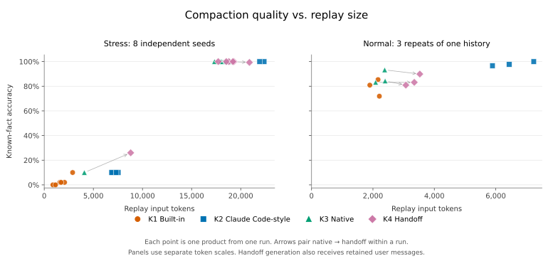

# 附录：全部样本与原始诊断

本附录保留未经筛选的八个高密度样本、三个开发重复和全部诊断。[最终报告](README.md)的主表采用事后确定的七个高密度样本；原始数据和本附录没有按分数删除。

2026-10-20 16:32–17:22（America/Los_Angeles），OpenAI 订阅端点、Responses Lite、GPT-6.1 Sol / medium。锁定计划共 127 次请求，全部完成；没有自动重试或按成绩重新生成。

**高密度材料重现了原生压缩与 handoff 的总体优势，也重现了偶发的低分；开发任务的精确细节恢复则是详细文字摘要更好。** 两种任务分别报告，不能合成一个“最好 prompt”的排名。

## 四条路线与样本

| 当前编号 | 生成路线 | 旧五路编号 |
|---|---|---|
| K1 | 完整历史 + Codex 内置 prompt | K1 |
| K2 | 完整历史 + Claude Code 式详细 prompt | K3 |
| K3 | 完整历史 + 原生 compaction trigger | K4 |
| K4 | U + 同一份 K3 + 当前生产 handoff prompt | K5 |

旧 K2（bridge 标准 prompt）不再参与新实验。旧报告保留旧编号。K2 的实际冻结 prompt 存在一处示例占位措辞偏差，见[来源说明](../../README.md#固定的四条路线)；本批没有更换已经测试的字节。

- 高密度：八个 seeds，旧四个 3617031–3617034，加新四个 3617131–3617134；每 seed 每路线一次生成。每份历史有 1,000 条权威记录、十个阶段，约 215k 服务端 input tokens；每份测验 150 道已知题、5 道无答案题。
- 开发任务：同一份约 31k tokens 的虚构开发历史，三次独立生成；每次 89 道已知题、4 道无答案题。它是一个工作场景的重复，不能算三个独立工作负载。
- 诊断：四对工具声明实验，共八份新原生产物；另外重读五份冻结检查点。

全部最终测验只收到固定公共前缀、对应 K 和题目，不含 U、完整历史或生成 reasoning。K4 **生成时**使用 U，因此它与 K3 的差值包含 U 的补充作用。所有恢复测验使用相同闭卷设置；不执行工具。

## 主结果

表中正确率为每个 case 等权的已知题平均值。长度为服务端 attribution 的 **K 产物 output tokens**，不含生成 reasoning；另列实际回放占用的 input tokens。均值后的括号为样本最小值–最大值，不是置信区间。

| 材料 | 路线 | 正确率 | 满分次数 | K tokens，均值（范围） | 回放 input tokens，均值 |
|---|---|---:|---:|---:|---:|
| 高密度 | K1 | 2.00% | 0/8 | 1,463.1（807–2,814） | 1,538.1 |
| 高密度 | K2 | 32.50% | 2/8 | 10,894.4（6,783–22,301） | 10,969.4 |
| 高密度 | K3 | 88.75% | 7/8 | 16,558.5（4,079–18,939） | 16,560.5 |
| 高密度 | K4 | 90.67% | 6/8 | 17,732.5（8,723–20,808） | 17,807.5 |
| 开发任务 | K1 | 79.40% | 0/3 | 2,015.0（1,822–2,133） | 2,092.0 |
| 开发任务 | K2 | 98.13% | 1/3 | 6,446.7（5,817–7,161） | 6,523.7 |
| 开发任务 | K3 | 86.89% | 0/3 | 2,287.3（2,086–2,395） | 2,289.3 |
| 开发任务 | K4 | 84.64% | 0/3 | 3,238.3（2,995–3,450） | 3,315.3 |



图中每一点是一份产物，箭头连接同一次 K3 与其 K4；左右两图的 token 横轴范围不同。[SVG 原图](quality-vs-size-all.svg)可单独下载，也可用绘图脚本导出 PNG。[summary.json](summary.json)另含样本标准差、旧/新 seeds 分组、类别、阶段和逐题配对变化。

八个高密度完整历史基线均为 150/150，空历史基线均为 0/150；开发基线分别为 89/89 与 0/89。全部主实验 K 的无答案题均正确返回 null，不混入上表的已知题正确率。

### 每个样本

单元格为“答对数 / K 产物 tokens”；高密度每行满分 150，开发每行满分 89。

| 样本 | K1 | K2 | K3 | K4 |
|---|---:|---:|---:|---:|
| stress-3617031 | 0 / 889 | 150 / 22,301 | 150 / 18,455 | 150 / 18,715 |
| stress-3617032 | 0 / 958 | 150 / 21,847 | 150 / 18,060 | 150 / 18,456 |
| stress-3617033 | 3 / 1,520 | 15 / 7,428 | 150 / 17,327 | 150 / 17,633 |
| stress-3617034 | 15 / 2,814 | 15 / 6,878 | 150 / 17,979 | 150 / 19,172 |
| stress-3617131 | 0 / 807 | 15 / 7,449 | 150 / 18,858 | 149 / 20,808 |
| stress-3617132 | 0 / 1,078 | 15 / 7,222 | 150 / 18,939 | 150 / 19,226 |
| stress-3617133 | 3 / 1,995 | 15 / 6,783 | 150 / 18,771 | 150 / 19,127 |
| stress-3617134 | 3 / 1,644 | 15 / 7,247 | 15 / 4,079 | 39 / 8,723 |
| normal-r1 | 64 / 2,133 | 86 / 5,817 | 74 / 2,086 | 74 / 3,270 |
| normal-r2 | 76 / 2,090 | 87 / 6,362 | 83 / 2,381 | 80 / 3,450 |
| normal-r3 | 72 / 1,822 | 89 / 7,161 | 75 / 2,395 | 72 / 2,995 |

## 与历史对比，发生了什么

重新核对原始记录后，确认旧的好结果不只来自 xhigh：旧 medium 高密度 holdout 的八份原生检查点全部满分。但是后续 handoff 批次是八份**新生成**的检查点，其中已有一份原生 24/150、handoff 39/150 的低分。旧两批不能混为同一组配对。

| 高密度批次 | 独立 seeds × 每 seed 生成次数 | 路线 | 已知题均值 | K output tokens 均值 | 回放 input tokens 均值 |
|---|---|---|---:|---:|---:|
| historical-holdout | 4 × 2 | K1 对应路线 | 1.25% | 994.5 | 1,069.5 |
| historical-holdout | 4 × 2 | 原生 | 100.00% | 17,721.4 | 17,723.4 |
| historical-restatement | 4 × 2 | handoff | 90.75% | 16,980.0 | 16,978.0 |
| historical-restatement | 4 × 2 | 原生 | 89.50% | 16,254.9 | 16,256.9 |
| historical-claude-code | 4 × 2 | K2 对应路线 | 79.75% | 18,711.2 | 18,786.2 |

本次八份原生均值 88.75%、handoff 90.67%，与旧 restatement 的 89.50%、90.75% 接近，主要模式得到重现。详细文字路线从旧批次 79.75% 降到本批 32.50%；可见产物从全量表格转向只记录最近阶段的次数增多，但尚不能确定由哪个请求参数或采样因素造成。历史条件不同，这些不是统计显著性结论。

历史与当前的 H、BASE、题目和 U 相同部分已按内容核验。原生生成 body 的变化是：增加工具声明、增加 summary:auto、移除 verbosity:low。恢复和 handoff 还有包装、参数与路由条件差异。详见[历史请求差异审计](../../replication-audit.md)；[历史逐样本数据](historical-comparison.json)保留 40 个产品观测，分别列出各批，不合并成受控排名。

### 冻结检查点重读

- 四份旧高分检查点使用当前 reader：全部仍为 150/150。
- 上一轮 129/150 的检查点使用历史 reader：仍为 129/150，仍只失去早期工具结果题。

这排除了“只要换回旧 reader 就能修复上一份低分”的解释，并不等于解密观察到了压缩器内部遗漏。

### 只改变工具声明

四个旧 seeds 各跑一对：旧生成 body 原样复现，与只在开头增加 additional_tools 的版本；两者使用同一个当前闭卷 reader。

| seed | 旧 body：得分 / K tokens | 只加工具：得分 / K tokens |
|---|---:|---:|
| 3617031 | 150/150 / 17,413 | 150/150 / 17,487 |
| 3617032 | 150/150 / 17,996 | 150/150 / 18,066 |
| 3617033 | 150/150 / 17,935 | 150/150 / 18,844 |
| 3617034 | 150/150 / 17,289 | 30/150 / 4,164 |

旧 body 四份均满分；只加工具三份满分、一份 30/150。低分只答对 epoch 0 与 9，中间八个阶段全部返回 null；没有截断、工具调用或协议错误。同 seed 在本批主实验的当前参数下仍为 150/150。工具声明的影响值得后续继续测，但四对样本不能证明稳定因果，也不能据此建议正常请求删除工具。

## 失败案例说明了什么

**文字摘要主动省略。** 六份高密度 K2 只恢复 epoch 9 的 15 条被测事实。可见摘要明确要求回原会话查询更早数据；这些请求均正常完成，没有设置 max_output_tokens，也没有 incomplete。两份满分 K2 用表格保留全部记录。这是同一 prompt 的实际产物差异，不是评分器把旧数据判无效。[示例产物](cases/stress-3617131/K2.txt)。

**原生压缩也会短得多。** seed 3617134 的 K3 只有 4,079 tokens，仅答对最后阶段的 15 题。K4 为 8,723 tokens、39/150；它新增答对的 24 条事实全部存在于 handoff 输入 U，不能称为从密文中找回了已丢内容。公开的 [K4](cases/stress-3617134/K4.txt)用明确前缀规则和表格表达这些值。原生密文不可读，因此无法严格区分 K3 中未保存与 reader 未提取。

**有事实也可能答错。** seed 3617131 的 K4 为 149/150，唯一错误把 33 号记录与 133 号混淆；正确值仍在 [K4 明文](cases/stress-3617131/K4.txt)。这是一项可证明的读取错配，不应归为 handoff 删除事实。开发 r1 的 K4 也有明确写出最后读取文件却答 null 的情况。

**开发总分不等于安全接续能力。** 三次开发实验的 K2/K3/K4 均正确恢复当前提交权限、R1–R3 尚未实施、旧绿灯不能证明新修复；review 的 10 题和 next_steps 的 5 题均全对。差距主要包含精确字段、旧测量数字等，也有真实信息混淆：例如某份 K2 把 bytes 写成 size；部分原生或 handoff 恢复测验未答出 API 字段名。严格评分还把 Driftship 写成 driftship 判为整题错误。原始分数保留，未按结果改 gold 或放宽比较。

开发 r1 的 K3/K4 还遗漏了“用户早先曾允许本地提交”这一已被撤回的历史权限（Q079），但正确回答了当前未授权（Q002）。两者不能混为当前权限误判。

因此本批支持“高密度时原生与 handoff 通常保留更多精确数据”，不支持“任何开发对话都优于详细文字摘要”。篇幅提供有用线索，但不能替代逐题质量判断。

## Token、用量与局限

`product_output_tokens` 来自生成响应目标 output item 的 attribution，排除生成 reasoning。`replay_input_tokens` 从 reader input 中扣除新输出项的 input framing，再减去相同 fixture、前缀和参数的空历史基线；原生另与直接输入 item attribution 核对。文字回放包含固定 summary wrapper，因而大于纯 K 长度。

开发 r2/r3 复用 r1 的相同空基线；工具对照与 current reader 重读使用同 seed 的空基线。historical reader 的前缀不同，直接使用原生输入项 attribution，不减去不匹配的 current 基线。旧 handoff 没有当前的文字 wrapper；这也解释同样文本的生成与回放 token 口径差异。

K4 长度只表示最终 handoff 文本；完整生成成本包含 K3 + handoff。实验中共享的 K3 实际只生成并计费一次。共 52 次生成、75 次问答；每次请求的 input/output、reasoning、cached 和耗时见 [requests.csv](requests.csv) / [requests.json](requests.json)。

| 阶段 | 请求数 | Input tokens | Output tokens | Cached input |
|---|---:|---:|---:|---:|
| main_generation | 44 | 6,206,551 | 419,766 | 50,688 |
| main_reader | 62 | 2,620,021 | 179,392 | 130,944 |
| native_ablation_generation | 8 | 1,717,942 | 129,194 | 226,816 |
| native_ablation_reader | 8 | 193,450 | 33,789 | 16,896 |
| reader_diagnostic_reader | 5 | 127,130 | 22,132 | 4,096 |

cached 已包含在 input 中，不额外相加。问答是实验成本，不是每次产品压缩的必需调用；未换算金额。本实验没有模拟完整工作会话的暖身与缓存路由，低 cached 数值不能代表实际客户端的缓存命中率。

样本量是八个 seeds 与一个开发历史的三次生成，不能把 1,200 道高密度题当成 1,200 次独立压缩。题目同一模板，覆盖有限；没有测试后续真实开发执行、其他模型或跨模型 reader。模型别名也未固定服务端快照。没有为低分额外重跑或修改 prompt。

## 公开材料与复跑

- [plan.json](plan.json)：开跑前锁定的样本、诊断与源码 hash。
- [results.json](results.json)：逐题 gold、actual、评分、类别与 epoch；[summary.json](summary.json)：分组和配对统计。
- `fixtures/`：全部八份高密度输入、开发输入、题目及固定前缀。`prompts/`：实际文本快照。
- `cases/`：33 份主实验文字 K、75 份原始问答文本、原生 metadata。真实服务 ID 与密文留在私有运行记录，公开 metadata 无法直接回放；复跑需生成自己的 K。
- [artifacts.json](artifacts.json)：公开材料的 SHA-256 与 bytes。产物为原始实测文本，没有人工改写。

从仓库根目录，按[通用用法](../../README.md#手动运行)提供自己的 URL 和鉴权环境变量；例如：

```sh
node benchmarks/compaction/run.mjs \
  --fixture benchmarks/compaction/results/2026-10-20-replication/fixtures/stress-3617031.json \
  --model gpt-6.1-sol --out benchmarks/compaction/runs/repeat-3617031 --execute
```

其余 seeds 替换文件名即可；开发任务使用本目录 `fixtures/normal.json` 和 `--questions fixtures/normal-questions.json`（均需写完整仓库相对路径），使用三个不同的输出目录，后两次可设 `--controls none`。诊断由独立脚本运行，见[工具声明与读取实验](../../README.md#单独核对工具声明与读取设置)。公开版本不读取任何设备登录文件。

图可从公开 JSON [重新生成](../../README.md#重绘已记录的结果)。输入、题目、产物和原始分数均已归档；常规运行目录仍被忽略，本次样本按明确授权提交。历史五路报告只修正来源措辞，原始编号、产物和成绩不变。开发素材的旧 metadata 中“未使用模型生成”描述不准确，沿用[既有勘误](../2026-10-20-medium/README.md)，不把它当作来源保证。

离线核验全部公开文件 hash，并从 75 份原始问答重新评分，不调用 API：

```sh
node benchmarks/compaction/verify-record.mjs benchmarks/compaction/results/2026-10-20-replication
```

本 benchmark 不加入 CI、发布包或 bridge 运行时。
