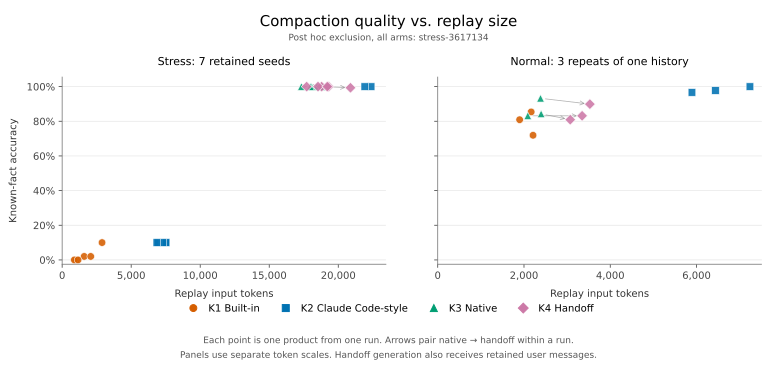

# 四路压缩最终报告

GPT-6.1 Sol / medium，OpenAI 订阅端点、Responses Lite。实测时间为 2026-10-20 16:32–17:22（America/Los_Angeles）。本报告记录的 106 次请求全部成功完成；本报告按后续讨论选定的口径，从主结果剔除一个极端低分案例。

**保留的七个高密度样本中，原生压缩恢复正确率为 100%，随后 handoff 为 99.90%；开发任务仍是详细文字摘要的精确细节恢复率最高。** 这两类材料分别呈现。

## 路线与样本选择

| 编号 | 生成路线 |
|---|---|
| K1 | 完整历史 + Codex 内置 prompt |
| K2 | 完整历史 + Claude Code 式详细 prompt |
| K3 | 完整历史 + 原生 compaction trigger |
| K4 | U + 同一份 K3 + 当前生产 handoff prompt |

最终测验只使用对应 K、固定公共前缀和题目，不带 U、完整历史或生成 reasoning。K4 生成时使用 U；K3→K4 的变化包含用户历史补充和后续读取的影响。实际 prompt 的来源及示例占位措辞差异见[快照说明](../../README.md#固定的四条路线)。

本报告采用以下明确选择：

- **主实验高密度剔除 stress-3617134 整个案例**，四条路线统一使用其余七个 seeds。该案例 K3 仅生成 4,079 tokens，得分 15/150；依赖它的 K4 为 39/150。
- 这是查看结果后按用户要求确定的**事后选择**，不是开跑前约定的阈值、自动离群检验或已经证实的协议故障。筛选结果用于描述保留样本的表现。
- K2 的六份 15/150 在全样本中占多数，不作为孤立异常删除；上述整案例剔除后仍保留其中五份。开发任务三次重复全部保留。
- 全部八个高密度样本、三个开发重复和实际请求用量见[全样本附录](all-samples.md)。

[report-summary.json](report-summary.json)记录选择原因、明确的 included/excluded case IDs 和重算结果；评分、gold 和产物保留全部样本。没有重新请求模型或按结果改写产物。

## 最终主结果

高密度每个 seed 有 150 道已知题，七份共 1,050 题；开发材料是同一历史的三次独立生成，每次 89 道已知题，共 267 题。正确率按 case 等权；同组每份题数相同，因此也等于总答对数除以总题数。

K tokens 是目标产物的 output item attribution，不含生成 reasoning。括号是各样本最小值–最大值，不是置信区间。回放 input tokens 另含必要的文字 wrapper 或原生 item framing。

| 材料 | 路线 | 答对 / 题数 | 正确率 | 满分次数 | K tokens，均值（范围） | 回放 input tokens，均值 |
|---|---|---:|---:|---:|---:|---:|
| 高密度 | K1 | 21/1050 | 2.00% | 0/7 | 1,437.3（807–2,814） | 1,512.3 |
| 高密度 | K2 | 375/1050 | 35.71% | 2/7 | 11,415.4（6,783–22,301） | 11,490.4 |
| 高密度 | K3 | 1050/1050 | 100.00% | 7/7 | 18,341.3（17,327–18,939） | 18,343.3 |
| 高密度 | K4 | 1049/1050 | 99.90% | 6/7 | 19,019.6（17,633–20,808） | 19,094.6 |
| 开发任务 | K1 | 212/267 | 79.40% | 0/3 | 2,015.0（1,822–2,133） | 2,092.0 |
| 开发任务 | K2 | 262/267 | 98.13% | 1/3 | 6,446.7（5,817–7,161） | 6,523.7 |
| 开发任务 | K3 | 232/267 | 86.89% | 0/3 | 2,287.3（2,086–2,395） | 2,289.3 |
| 开发任务 | K4 | 226/267 | 84.64% | 0/3 | 3,238.3（2,995–3,450） | 3,315.3 |

每点代表一份产物；箭头连接同次 K3 与 K4。图中明确标出事后剔除的案例。高密度与开发图采用不同的 token 横轴范围。原始八样本图保留在[附录](all-samples.md#主结果)。

所有保留产物的无答案题均正确返回 null；这些题没有混入上表。已运行的全部完整历史基线均满分，空历史基线的已知题均为零分。

## 分析总结

- **本次高密度状态保留实验中，K3、K4 效果最好。** 完整八样本和事后筛选的七样本均领先 K1、K2，handoff 总体接近原生压缩的恢复能力。这里的高密度指长历史中包含大量精确状态；实验没有单独控制历史长度，不能仅以 token usage 高低推断效果。
- **K2 在两类材料中都优于 K1。** 高密度场景不及 K3、K4；开发场景则保留了更多可精确恢复的细节，成绩更高。代价是更长的产物和更多回放 tokens：开发材料的 K2 平均约 6.4k tokens，K1/K3/K4 分别约 2.0k/2.3k/3.2k。产物长度不等于总生成成本，K4 的完整路线还包含 K3 的生成。
- **开发场景的得分差距可能部分来自信息取舍。** K3、K4 可能优先保留继续工作所需的核心状态，舍弃了一些低价值或可以重新读取、查询的信息。K2、K3、K4 都保留了当前权限、待处理 review 和下一步，支持考虑这一解释；但本实验没有验证模型的取舍意图、遗漏信息的实际工作价值或重新获取的成本。差距还包含精确字段缺失、reader 漏读和严格字符串匹配，因此不能把全部失分都解释为合理舍弃，也不能仅凭 K2 的答题高分断定实际续作一定更好。

## 结果解释

**高密度保留样本中，handoff 的精确恢复接近原生。** 七份 K3 全部 150/150；六份 K4 为 150/150，一份为 149/150。唯一错题把 33 号与 133 号记录关联错，正确值仍在[该 K4 明文](cases/stress-3617131/K4.txt)。这项错误可定位到读取环节，不是该事实从 handoff 中消失。

**详细文字摘要有两种明显行为。** 两份 K2 用表格保留数据并满分，其余保留样本只恢复最近阶段的 15 题。可见摘要要求回原会话查询早期值；没有接口截断或输出上限。这种反复出现的低分仍属于主结果。

**开发任务的结果不同。** K2 平均 98.13%，K3 为 86.89%，K4 为 84.64%。三者都正确恢复当前提交权限、待处理 review 和下一步；差距包含精确字段、历史数字，也有 reader 漏读和严格字符串匹配带来的扣分。不能用高密度材料的排名代替实际开发任务的全部质量判断。

逐案例分数、产物长度和具体信息丢失的例子见[全样本附录](all-samples.md)。

## 全样本对照与适用范围

| 高密度路线 | 原始八样本正确率 | 主表七样本正确率 |
|---|---:|---:|
| K1 | 2.00% | 2.00% |
| K2 | 32.50% | 35.71% |
| K3 | 88.75% | 100.00% |
| K4 | 90.67% | 99.90% |

原始结果仍显示一次较弱的原生压缩；事后剔除不构成对服务故障原因的证明，也不提供未来请求的成功率保证。保留的七个 seeds 共享模板，1,050 道题不是 1,050 次独立压缩。开发重复也只覆盖一个虚构场景。模型别名没有固定服务端快照。

产物长度有助于解释表现，但不能替代质量评分。K4 的最终文本长度只计 handoff，完整生成成本包含 K3 和 handoff；全部实际请求用量仍包含被剔除案例，cached input 已包含在 input 中。此实验未模拟完整工作会话缓存路由，不据此推断正常客户端的缓存命中率。

## 材料、复跑与核验

- [report-summary.json](report-summary.json)：本报告的事后选择与重算统计。
- [results.json](results.json)、[summary.json](summary.json)：未筛选的逐题评分、原始分组与配对统计。
- [plan.json](plan.json)：生成与评分的样本、参数和源码快照；报告筛选另记在 report-summary 中。
- `fixtures/`、`prompts/`、`cases/`：全部八份高密度输入、开发材料、题目、实际 prompt、33 份文字 K 和 62 份回答。原生仅公开匿名 metadata。
- [requests.csv](requests.csv) / [requests.json](requests.json)：全部 106 次请求（44 次生成、62 次问答）的用量与设置。
- [artifacts.json](artifacts.json)：公开文件 hash。原始密文、服务标识和凭据不公开。

复跑已记录样本见[附录](all-samples.md#复跑)，通用调用、离线核验和绘图命令见[benchmark 文档](../../README.md#手动运行)。筛选只影响此次报告，不影响未来生成或评分。
