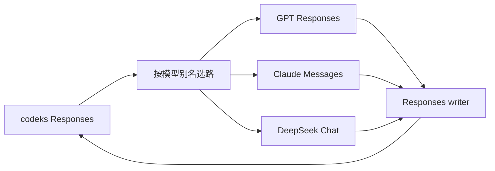

# 设计与取舍

## 独立 provider

bridge 是独立本地 HTTP 服务。codeks 负责工具执行、子代理、权限、工作区和会话持久化；bridge 负责模型协议转换。客户端只配置一个 Responses provider，每条请求的模型别名选择独立上游。

运行时只用 Node 内置模块，构建使用 TypeScript，测试使用 node:test。桥接器不依赖客户端启动方式，也不需要修改 codeks 源码。

## 客户端协议跟随 Codex

优先匹配最新 Codex 的 GPT 默认行为，以 OpenAI 订阅、AWS 和 Azure 的使用场景为基准。当前模型条目使用 Responses Lite，现代条目保留 Code Mode Only 和多代理字段；GPT-5.5 显式启用 Lite，其余工具与多代理元数据仍跟随源条目。目录固定到明确的 Codex 源码版本，不随用户本机二进制或订阅账号变化。

Lite 仍调用 `/responses` 并返回 Responses SSE。完整工具 schema 位于历史中的 `additional_tools` 项，普通函数和 custom 工具归入默认 `functions` namespace。GPT 路径保留这些声明的位置、顺序、schema 和 grammar，并发送 `x-openai-internal-codex-responses-lite: true`。Claude 默认将初始声明放到顶部，增量声明转换为原生中途工具更新；DeepSeek 及 Claude 的显式兼容模式将各批定义合并到顶部。声明不会变成 user reminder。中途提醒保留所在对话位置；若插在一次完整的工具交换内，则移至该批结果之后，以满足目标协议的配对要求。

已核对 Codex `0.163.0`：Lite 设置 `reasoning.context: "all_turns"` 和 `parallel_tool_calls: false`。bridge 保留客户端传入值，原生 options 仍可按配置覆盖普通参数。reasoning 的来源筛选与服务端 context 语义是两件事：前者决定发送哪些载荷，后者决定 GPT 如何使用它们。原生压缩与随后的复述保留源 Lite 工具声明及 transport 标记。

该版本现代 OpenAI GPT 条目启用 Lite，但原生 AWS Bedrock 目录仍主动关闭 Lite 和 Code Mode。bridge 在这些模型上保留 OpenAI 条目的行为，是本项目的明确选择，不能把它描述为所有官方 provider 当前完全相同的默认值。上游是否接受请求由端点裁决，错误直接返回；bridge 不自动转回另一种协议。升级时复核 `core/src/client.rs`、`tools/src/tool_spec.rs`、`core/src/context/world_state/top_level_tools.rs` 和 provider 的模型目录处理。

## 有限目录与显式精调

项目只支持明确列出的模型。`catalog/` 保存每个模型的完整条目及来源；GPT 分别使用 Codex 源码中各自的版本，保留提示词、默认 effort、摘要、窗口和工具元数据的差异，GPT-5.5 的 Lite 调整单独记录在 `adjustments`。Claude 与 DeepSeek 从 GPT-6.1 Sol 模板开始，只替换底层模型身份（如 `You are Codex, an agent based on Claude.`），保留 Codex 代理角色及 `As Codex` 人格说明；参数和确有差异的能力逐项精调，记录在条目的 `adjustments`。摘要默认值继续使用模板的 `none`，是否展示由客户端配置决定，不为第三方模型强制打开。

导入脚本只生成独立候选文件，供人或 Agent 对比审阅。运行时使用已提交的完整条目，不自动导入、不猜测未知模型，也不从 ChatGPT 订阅获取目录。这样更新仍有工具辅助，同时提示词和能力变化可审查、可追踪。来源及更新步骤见[模型目录](../catalog/README.md)。

## 配置表达策略，adapter 负责协议

`models.catalog` 选择条目；`upstreams` 包含连接、鉴权及共用的 adapter 设置；别名和真实部署名独立。目录条目决定 adapter，实际模型名不参与方言推断。模型窗口、输入模态、effort 映射、状态复用范围、压缩模式及执行模型可由配置覆盖。

协议专用桥接行为放在 `adapters.<adapter ID>`，模型逐字段覆盖连接，再取对应 adapter 默认值；原生请求参数仍通过开放的 `options` 浅层合并。这样的边界让未来 GPT、Messages 或 Chat 方言可以添加各自确有需求的设置，而不用在连接顶层堆积特例，也不提前维护空的配置对象或通用插件框架。配置行为不改变来源身份和模型目录。当前 Claude 的工具更新方式与 thinking 失配策略分别配置，因为前者保持工具前缀，后者还影响故障续接等其他历史变化；见 [Adapter 专用行为](config.md#adapter-专用行为)。

`src/profiles.ts` 将目录与配置组合为运行时 profile，同时用于客户端目录和出站请求，避免界面显示一套 effort、实际发送另一套。未覆盖字段保留原模型差异，不能用一套通用默认值改写所有 GPT。来源身份继续取连接、adapter 与实际部署，不因提示词更新或窗口预设改变。

`GET /v1/models` 提供 Codex 原生目录响应，CLI 默认生成显式 `model_catalog_url`；也可导出静态文件。两种目录都只包含 `expose` 未关闭的别名；`visibility: "hide"` 保留完整条目但在客户端选择器中隐藏，默认 `"list"`。目录省略与选择器隐藏分开，让内部压缩预设和仍需客户端元数据的 Memory、已有会话各取所需；两者都不改变调用权限或状态身份。服务启动时展开配置，目录与普通响应通过 ETag 关联，客户端看到新版本后刷新。目录只包含客户端需要的公开模型元数据，不包含连接或凭据配置。

底层 Chat 负责消息、工具、图片和 SSE；DeepSeek 方言只负责 thinking 参数、reasoning 字段和 usage。新增方言时复用稳定的协议部分，把差异留在对应 adapter。协议相同的模型版本可共用 adapter，参数差异先在新的目录条目中表达；真正改变载荷结构时再增加转换代码和格式版本。当前实现三类 adapter，不为尚未接入的模型维护空接口或版本矩阵。

## 历史保存事实，配置决定恢复

Reasoning 载荷记录来源、格式和原始数据；压缩载荷保存文字摘要及可选原生状态，或保存原生状态与按需复述配方。它们写入 Responses item 的 `encrypted_content`，由 codeks 原样持久化。bridge 不维护完整会话或响应 ID 索引；按需复述的成功结果及独立 usage 另存本地文件缓存，避免重复付费和服务重启后重复生成。

来源包括连接指纹、adapter 和实际模型，独立于显示别名和复用配置。连接凭据和 HTTP header 不写进载荷；复述配方保存源请求前缀及除输入、流式开关和文字输出约束外的请求参数，包括未知参数。外层编码不提供加密：文字 reasoning、签名、压缩摘要及请求前缀按普通聊天历史保护，按需复述缓存以 `0600` 文件权限保存。

每次请求按当前配置选取历史，不改写已保存载荷。bridge 能识别的 reasoning 和原生压缩有独立的允许来源列表，默认只接受自身，关系有方向且不传递。修改配置即可改变已有历史的恢复方式；格式版本负责解释数据，不编码“永远隔离”这类策略。

未识别状态默认透传，因为历史会话可能来自其他客户端或版本，bridge 无法解码不等于上游不能使用。模型级 `replay.unrecognized` 也可显式选择过滤或报错；不为这类状态猜测来源或生成 handoff。它与已识别载荷的来源策略分开，保留未来协议扩展与用户选择。[配置与协议边界](config.md#未识别的历史状态)

明文 reasoning 使用可共享的文本格式；不同 adapter 将来可把同一格式恢复到各自字段。密文与签名保留各自原生结构，不把格式可解码等同于上游允许使用。

## 进攻式发送，保留错误

这是快速迭代的协议桥接器。用户选择默认透传、尽早暴露不兼容：请求、响应、header 和错误中的新增字段不应因为桥接器未认识它们而静默消失。GPT 路径保留原始 body 和事件，只修改桥接必需字段；header 采用排除必要边界字段的方式转发，不维护白名单。Claude/DeepSeek 仍需转换消息、工具及错误结构，不能机械地把 Responses 字段搬进另一套协议；原生扩展参数通过 options 保留。具体 HTTP 与鉴权边界见 [Responses 流](responses-stream.md#header-与转发边界)。

bridge 检查自身必须维持的不变量：配置引用存在、历史能转换、工具调用完整、usage 可用、压缩检查点完整。这些检查避免静默丢失上下文或执行半段工具调用。

上游负责判定模型能力：effort、thinking、强制工具选择、schema、图片以及允许复用的密文是否可接受。bridge 不预先维护这些能力的限制列表，也不在失败后自动移除 reasoning、关闭 thinking、换端点或改压缩模式。原生参数可通过 options 显式覆盖。

Claude 默认主动请求服务端对前缀失配 thinking 使用 `drop_block`，保留其余可接受的块。这是已配置的请求策略，不是在收到错误后重试或改写已存历史。它允许流式故障后的部分回答继续工作，但丢失 reasoning 仍可能影响质量或增加重新推理的开销，不能视作无损。检查器展示上游实际报告的丢弃位置和原因，区分 bridge 的来源过滤与服务端判断。协议与恢复时序见 [Claude Messages](backends-anthropic.md#失配策略与故障续接)。

GPT 原生 HTTP 失败保留 status、body 和诊断 header，流内失败保留 error 对象。下游 HTTP 200 推迟到上游接受请求后，避免把 HTTP 失败变成 SSE 错误而改变 codeks 的重试判断；等待响应头期间没有 keepalive，是这一选择的明确代价。Claude/DeepSeek 只在协议转换边界映射错误分类。重试和退避由客户端控制，bridge 不叠加第二层重试。详见 [Responses 流](responses-stream.md)。

## 压缩的生成和恢复分开

`compaction.mode` 决定如何生成：`summary` 用标准 prompt 汇总原历史；`native` 先生成原生检查点，只在目标需要文字时由原来源复述。默认值取工作模型，GPT 默认 `native`，其他 adapter 默认 `summary`。`compaction.model` 独立选择已有模型别名作为执行者，仅跟随一层引用，不继承执行者自己的委托或模式。这样 Claude 也可明确选择 GPT 原生压缩，同时保留标准文字模式。

先选执行者，再按它的来源策略恢复输入。兼容的 GPT 压缩器可以继续读取旧原生状态，不必沿用工作模型此前使用的文字表示。来源身份、参数与复述配方记录实际执行者；消费者的 `native_replay` 保持独立。未设置执行别名或引用自身别名时保留请求 effort；引用其他别名时选择执行别名的默认 effort，复述沿用保存的请求参数。

用户选择先原生再复述，是为了以原生压缩整理的状态为交接基础；按需执行则可省去始终使用兼容目标时的额外推理。这是可选的质量策略，不承诺所有输入上的质量优势、缓存命中或固定成本。实际模型容量由上游裁决，bridge 不引入跨模型 token 换算或自动裁剪。

按需复述使用 `U + K + handoff prompt`：`U` 直接取自后续请求中客户端实际保留的历史，`K` 是原生检查点。bridge 先交付 K，由客户端确定 U，下一条需要文字的请求等待复述完成；不复制客户端的保留算法。bridge 不再裁剪 U，不保存完整旧历史，也不把检查点后的新工作纳入旧摘要。复述 prompt 是用户给定的 Codex prompt 微调版，要求完整复述已有状态；summary 模式继续使用现有的详细标准 prompt。

`native_replay` 和来源列表决定恢复时是否使用原生表示，独立于生成模式。目标无法使用原生时，选择已有文字或向原来源按需生成文字。这项能力用于模型切换，假定原模型、原端点和配置仍可用；缓存只复用成功结果，错误直接返回。已经发送的原生状态被上游拒绝时不会自动降级。支持原生格式不等于每个部署都提供生成能力，因此同一 GPT adapter 可配置不同模式。[压缩细节](compaction.md)

## 调试捕获只观察

[检查器](inspect.md)记录 bridge 真正收发的字节，不重新构造请求。入口请求在解析前保存原文；所有上游请求都经过 `upstreamFetch`，在这里保存实际发送的 JSON 和逐块到达的响应；写回 codeks 的内容在 `writeHead`/`write`/`end` 处记录。每条请求在 AsyncLocalStorage 中持有自己的记录，上游调用按用途附加 `main`、`summary`、`native` 或 `handoff` 标签，因此并发会话和子代理不会混在一起，后端代码不需要传递捕获参数。需要生成文字摘要时，`handoff` 先完成，再执行目标调用；命中摘要缓存时没有辅助上游调用。客户端响应只报告对应 main、summary 或 native 调用的 usage；handoff 用量留在缓存与独立上游记录，避免把辅助消耗当作客户端当前上下文。

服务端保存完整正文，折叠、截断和格式化都在页面完成，避免字段白名单遗漏协议新增内容。状态标注调用与 `prepareHistory` 相同的回放判断函数，显示的决定不会与实际转换分叉。页面是零依赖的静态文件，和运行时一样不引入第三方包。捕获关闭时不保存任何内容，每条请求只多一个 AsyncLocalStorage 作用域。

## 协议边界

客户端按目录条目发送 Responses Lite 或普通 Responses 历史。Responses 后端保留 namespace 与 grammar；Claude/DeepSeek 将它们转换成普通函数并恢复调用身份。Lark/regex 只转换为描述约束，不追加特定工具的提示词。

Responses 后端保留原生事件及 response envelope，其他后端由 writer 生成 Responses 协议。writer 从第一个工具起缓存全部后续事件，成功后按原顺序交付，失败时整体丢弃；代价是工具之后的文字也暂时不能显示。Reasoning item 的载荷必须出现在 `output_item.done`，确保 codeks 可以保存。远程 V2 压缩也由同一个 writer 返回，客户端继续执行自己的历史保留规则。

Codex 的命名通知可以没有 `call_id`，Code Mode 的多次 `notify()` 也可以复用同一个调用 ID。非 Responses 目标将无配对通知及追加结果转成带身份的 user 消息，保留文字和图片，不补造工具调用或改写此前结果。转换只影响当前出站请求；规则和边界见[工具转换](tools.md)。

协议转换参考了现有 Responses、Messages 和 Chat 实践。标准文字压缩使用详细摘要提示词；原生检查点复述 prompt 改编自 Codex，摘要恢复前缀逐字来自 Codex。Apache-2.0 许可归属列在 `NOTICE`。
