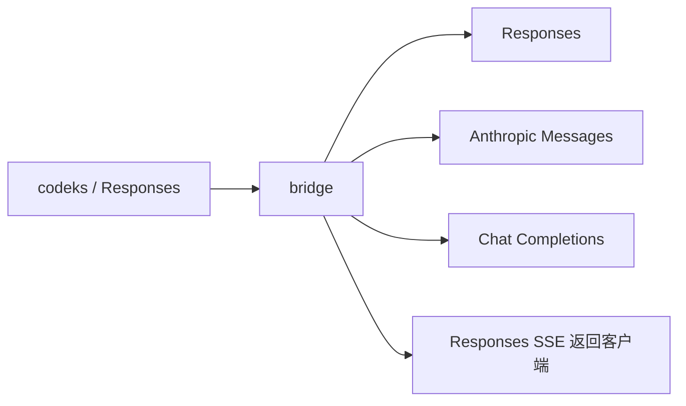

# 设计与取舍

## 独立 provider

本项目是独立本地 HTTP 服务和未来的独立 npm 包。它不启动、不包裹也不修改客户端，客户端仍负责工具执行、子代理、权限、工作区与历史持久化。一个服务可以配置多个上游；请求中的模型别名决定上游连接及实际模型。

运行时零第三方依赖，Node 提供 HTTP、fetch、SSE 字节处理、加密哈希和子进程鉴权命令。构建只使用 TypeScript，测试使用 node:test。实现分为配置/鉴权、历史选择、工具映射、后端转换、压缩协调和 Responses writer。

选择独立 provider 是因为转换完全位于模型接口边界。它不需要跟随客户端的进程管理、UI 或安装方式同步，也可以连接多个上游。模型目录从当前客户端的 bundled catalog 派生，以保留客户端所需字段，避免在本仓库复制一套容易过时的工具和指令元数据。

## 历史归客户端

bridge 不维护数据库或响应 ID 索引。Reasoning 与压缩封装写进 Responses item 的 `encrypted_content`，客户端原样持久化并在后续请求带回。因而重启服务、恢复客户端会话和子代理 fork 都不需要另一个状态服务。

这个字段名来自协议，不能据此认为封装提供保密性。只有原生 GPT ciphertext 本身仍由上游加密。文字 reasoning、签名与可移植压缩摘要的保存权限和普通聊天历史相同。

Reasoning 身份包含上游配置 ID、API 类型、端点和实际模型。显示别名不同但指向同一身份可共享；模型或连接身份不同则在请求构建时过滤。原存储不变，切回可恢复。压缩也按该身份选择原生 checkpoint，否则使用文字摘要。

## 协议边界

客户端和 bridge 使用完整 Responses 协议。Responses Lite 省略工具定义，无法用于通用转换，因此生成的 catalog 设置 `use_responses_lite: false`。此设置保留模板的 code mode、多代理版本等客户端能力。

- Responses 后端保留原生工具定义和语法，清理依赖上游存储的 item ID。
- Messages 与 Chat 后端把 namespace/custom tools 转成普通函数，收到调用后还原到客户端工具身份。
- backend 在完整成功前缓存工具调用。错误或截断不能让半段工具参数进入执行。
- HTTP 错误、流内错误和重试提示统一映射回 Responses。bridge 自己不叠加重试；客户端控制预算与退避。
- 对不支持且会丢失语义的输入明确报错。Messages/Chat 不广告不在范围内的 hosted tools。

## 压缩与模型切换

GPT 的 native compaction 与文字摘要读同一份原历史，并行执行。只有两者都完成才对客户端发布一个 checkpoint。其他后端只生成文字摘要，仍通过客户端的远程 V2 压缩通道返回，因此客户端继续使用它自己的保留消息预算。参见[压缩](compaction.md)。

窗口、输出上限与模型名字由用户配置，bridge 不猜测上游容量。不能根据协议转换推断模型质量或同等任务表现；合成协议测试和实际工具回环验证的是互操作行为。

## 借鉴与来源

设计调研比较了现有 Responses↔Messages 和 Responses↔Chat 转换实践，采用边界适配、函数工具转换和完整响应后提交工具调用。没有复制其他项目的运行时代码。压缩 prompt 逐字来自 Apache-2.0 许可的 OpenAI Codex，出处列在 `NOTICE`。
