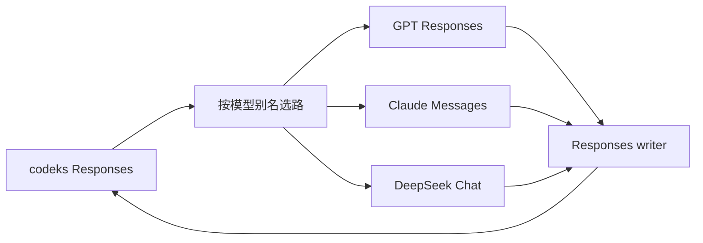

# 设计与取舍

## 独立 provider

bridge 是独立本地 HTTP 服务。codeks 负责工具执行、子代理、权限、工作区和会话持久化；bridge 负责模型协议转换。客户端只配置一个 Responses provider，每条请求的模型别名选择独立上游。

运行时只用 Node 内置模块，构建使用 TypeScript，测试使用 node:test。桥接器不依赖客户端启动方式，也不需要修改 codeks 源码。

## 配置表达策略，adapter 负责协议

`upstreams` 只包含连接与鉴权，`models.adapter` 明确选择方言。实际模型名可以是云端部署别名，不参与方言推断。模型窗口、输入模态、effort 映射、状态复用范围和压缩模式都在配置中表达。

`src/profiles.ts` 是三个 adapter 的格式与默认值来源。配置覆盖后的 profile 同时用于 catalog 和出站请求，避免界面显示一套 effort、实际发送另一套。客户端指令、code mode 和多代理元数据仍取自当前 codeks 的 bundled catalog。

底层 Chat 负责消息、工具、图片和 SSE；DeepSeek 方言只负责 thinking 参数、reasoning 字段和 usage。新增方言时复用稳定的协议部分，把差异留在对应 adapter。协议相同的模型版本可共用 adapter，参数差异先用配置；真正改变载荷结构时再增加转换代码和格式版本。当前实现三类 adapter，不为尚未接入的模型维护空接口或版本矩阵。

## 历史保存事实，配置决定恢复

Reasoning 载荷记录来源、格式和原始数据；压缩载荷保存文字摘要及可选原生状态。它们写入 Responses item 的 `encrypted_content`，由 codeks 原样持久化。bridge 无需数据库、响应 ID 索引或跨请求状态缓存。

来源包括连接指纹、adapter 和实际模型，独立于显示别名和复用配置。端点与凭据不写进载荷。外层编码不提供加密：文字 reasoning、签名、压缩摘要的保存权限与普通聊天历史相同。

每次请求按当前配置选取历史，不改写已保存载荷。Reasoning 和原生压缩有独立的允许来源列表，默认只接受自身，关系有方向且不传递。修改配置即可改变已有历史的恢复方式；格式版本负责解释数据，不编码“永远隔离”这类策略。

明文 reasoning 使用可共享的文本格式；不同 adapter 将来可把同一格式恢复到各自字段。密文与签名保留各自原生结构，不把格式可解码等同于上游允许使用。

## 进攻式发送，保留错误

bridge 检查自身必须维持的不变量：配置引用存在、历史能转换、工具调用完整、usage 可用、压缩检查点完整。这些检查避免静默丢失上下文或执行半段工具调用。

上游负责判定模型能力：effort、thinking、强制工具选择、schema、图片以及允许复用的密文是否可接受。bridge 不预先维护这些能力的限制列表，也不在失败后自动移除 reasoning、关闭 thinking、换端点或改压缩模式。原生参数可通过 options 显式覆盖。

HTTP 和流内失败保留原始上游内容及可得的状态码，同时规范为 codeks 可识别的错误分类。重试和退避由客户端控制，bridge 不叠加第二层重试。详见 [Responses 流](responses-stream.md)。

## 压缩的生成和恢复分开

`compaction.mode` 决定生成文字摘要，或并行生成原生结果与摘要；`native_replay` 和来源列表决定恢复已有检查点时是否使用原生表示。支持原生格式不等于每个部署都提供生成能力，因此同一 GPT adapter 可配置不同模式。

双压缩两条请求都成功才发布检查点。恢复时，原生格式可读、来源允许且开启 native replay，便优先使用原生；其他情况按配置选择文字摘要。这是发送前的表示选择，已经发送的原生状态被上游拒绝时不会自动降级。[压缩细节](compaction.md)

## 协议边界

客户端发送完整 Responses 历史。Responses 后端保留 namespace 与 grammar；Claude/DeepSeek 将它们转换成普通函数并恢复调用身份。Lark/regex 只转换为描述约束，不追加特定工具的提示词。

后端在完整成功前缓存工具调用，Responses writer 统一交付历史项和 usage。Reasoning item 的载荷必须出现在 `output_item.done`，确保 codeks 可以保存。远程 V2 压缩也由同一个 writer 返回，客户端继续执行自己的历史保留规则。

设计参考了现有 Responses、Messages 和 Chat 转换实践，没有复制其他项目的运行时代码。摘要提示词的许可归属见 `NOTICE`。
