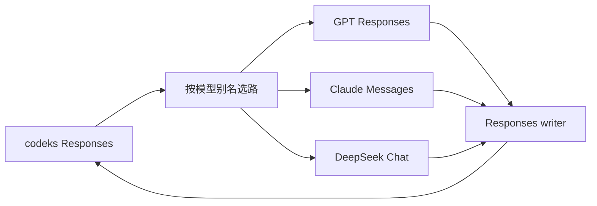

# 设计与取舍

## 独立 provider

bridge 是独立本地 HTTP 服务。codeks 负责工具执行、子代理、权限、工作区和会话持久化；bridge 负责模型协议转换。客户端只配置一个 Responses provider，每条请求的模型别名选择独立上游。

运行时只用 Node 内置模块，构建使用 TypeScript，测试使用 node:test。桥接器不依赖客户端启动方式，也不需要修改 codeks 源码。

## 客户端协议跟随 Codex

优先匹配最新 Codex 的 GPT 默认行为，以 OpenAI 订阅、AWS 和 Azure 的使用场景为基准。当前已审阅模型目录使用 Responses Lite，保留 `use_responses_lite: true`、Code Mode Only 和多代理字段。目录固定到明确的 Codex 源码版本，不随用户本机二进制或订阅账号变化。

Lite 仍调用 `/responses` 并返回 Responses SSE。完整工具 schema 位于历史中的 `additional_tools` 项，普通函数和 custom 工具归入默认 `functions` namespace。GPT 路径保留这些声明的位置、顺序、schema 和 grammar，并发送 `x-openai-internal-codex-responses-lite: true`。Claude/DeepSeek 只在各自协议转换入口提取声明，组合为原生工具表；声明不会变成 user reminder，其余消息保持原顺序。

已核对 Codex `0.163.0`：Lite 设置 `reasoning.context: "all_turns"` 和 `parallel_tool_calls: false`。bridge 保留客户端传入值，原生 options 仍可按配置覆盖普通参数。reasoning 的来源筛选与服务端 context 语义是两件事：前者决定发送哪些载荷，后者决定 GPT 如何使用它们。双压缩的原生与文字分支都延续同一 Lite 工具前缀及 transport 标记。

该版本最新 OpenAI GPT 目录启用 Lite，但原生 AWS Bedrock 目录仍主动关闭 Lite 和 Code Mode。统一启用是本项目的明确选择，不能把它描述为所有官方 provider 当前完全相同的默认值。上游是否接受请求由端点裁决，错误直接返回；bridge 不自动转回另一种协议。升级时复核 `core/src/client.rs`、`tools/src/tool_spec.rs`、`core/src/context/world_state/top_level_tools.rs` 和 provider 的模型目录处理。

## 有限目录与显式精调

项目只支持明确列出的模型。`catalog/` 保存每个模型的完整条目及来源；GPT 分别使用 Codex 源码中各自的版本，保留提示词、默认 effort、摘要、窗口和工具元数据的差异。Claude 与 DeepSeek 从 GPT-6.1 Sol 模板开始，只替换底层模型身份（如 `You are Codex, an agent based on Claude.`），保留 Codex 代理角色及 `As Codex` 人格说明；参数和确有差异的能力逐项精调，记录在条目的 `adjustments`。摘要默认值继续使用模板的 `none`，是否展示由客户端配置决定，不为第三方模型强制打开。

导入脚本只生成独立候选文件，供人或 Agent 对比审阅。运行时使用已提交的完整条目，不自动导入、不猜测未知模型，也不从 ChatGPT 订阅获取目录。这样更新仍有工具辅助，同时提示词和能力变化可审查、可追踪。来源及更新步骤见[模型目录](../catalog/README.md)。

## 配置表达策略，adapter 负责协议

`models.catalog` 选择条目；`upstreams` 只包含连接与鉴权；别名和真实部署名独立。目录条目决定 adapter，实际模型名不参与方言推断。模型窗口、输入模态、effort 映射、状态复用范围和压缩模式可由配置覆盖。

`src/profiles.ts` 将目录与配置组合为运行时 profile，同时用于客户端目录和出站请求，避免界面显示一套 effort、实际发送另一套。未覆盖字段保留原模型差异，不能用一套通用默认值改写所有 GPT。来源身份继续取连接、adapter 与实际部署，不因提示词更新或窗口预设改变。

`GET /v1/models` 提供 Codex 原生目录响应，CLI 默认生成显式 `model_catalog_url`；也可导出静态文件。服务启动时展开配置，目录与普通响应通过 ETag 关联，客户端看到新版本后刷新。目录只包含客户端需要的公开模型元数据，不包含连接或凭据配置。

底层 Chat 负责消息、工具、图片和 SSE；DeepSeek 方言只负责 thinking 参数、reasoning 字段和 usage。新增方言时复用稳定的协议部分，把差异留在对应 adapter。协议相同的模型版本可共用 adapter，参数差异先在新的目录条目中表达；真正改变载荷结构时再增加转换代码和格式版本。当前实现三类 adapter，不为尚未接入的模型维护空接口或版本矩阵。

## 历史保存事实，配置决定恢复

Reasoning 载荷记录来源、格式和原始数据；压缩载荷保存文字摘要及可选原生状态。它们写入 Responses item 的 `encrypted_content`，由 codeks 原样持久化。bridge 无需数据库、响应 ID 索引或跨请求状态缓存。

来源包括连接指纹、adapter 和实际模型，独立于显示别名和复用配置。端点与凭据不写进载荷。外层编码不提供加密：文字 reasoning、签名、压缩摘要的保存权限与普通聊天历史相同。

每次请求按当前配置选取历史，不改写已保存载荷。Reasoning 和原生压缩有独立的允许来源列表，默认只接受自身，关系有方向且不传递。修改配置即可改变已有历史的恢复方式；格式版本负责解释数据，不编码“永远隔离”这类策略。

明文 reasoning 使用可共享的文本格式；不同 adapter 将来可把同一格式恢复到各自字段。密文与签名保留各自原生结构，不把格式可解码等同于上游允许使用。

## 进攻式发送，保留错误

bridge 检查自身必须维持的不变量：配置引用存在、历史能转换、工具调用完整、usage 可用、压缩检查点完整。这些检查避免静默丢失上下文或执行半段工具调用。

上游负责判定模型能力：effort、thinking、强制工具选择、schema、图片以及允许复用的密文是否可接受。bridge 不预先维护这些能力的限制列表，也不在失败后自动移除 reasoning、关闭 thinking、换端点或改压缩模式。原生参数可通过 options 显式覆盖。

GPT 原生 HTTP 失败保留 status、body 和诊断 header，流内失败保留 error 对象。下游 HTTP 200 推迟到上游接受请求后，避免把 HTTP 失败变成 SSE 错误而改变 codeks 的重试判断；等待响应头期间没有 keepalive，是这一选择的明确代价。Claude/DeepSeek 只在协议转换边界映射错误分类。重试和退避由客户端控制，bridge 不叠加第二层重试。详见 [Responses 流](responses-stream.md)。

## 压缩的生成和恢复分开

`compaction.mode` 决定生成文字摘要，或并行生成原生结果与摘要；`native_replay` 和来源列表决定恢复已有检查点时是否使用原生表示。支持原生格式不等于每个部署都提供生成能力，因此同一 GPT adapter 可配置不同模式。

双压缩两条请求都成功才发布检查点。恢复时，原生格式可读、来源允许且开启 native replay，便优先使用原生；其他情况按配置选择文字摘要。这是发送前的表示选择，已经发送的原生状态被上游拒绝时不会自动降级。[压缩细节](compaction.md)

## 协议边界

客户端发送完整 Responses Lite 历史。Responses 后端保留 namespace 与 grammar；Claude/DeepSeek 将它们转换成普通函数并恢复调用身份。Lark/regex 只转换为描述约束，不追加特定工具的提示词。

后端在完整成功前缓存工具调用，Responses writer 统一交付历史项和 usage。Reasoning item 的载荷必须出现在 `output_item.done`，确保 codeks 可以保存。远程 V2 压缩也由同一个 writer 返回，客户端继续执行自己的历史保留规则。

设计参考了现有 Responses、Messages 和 Chat 转换实践，没有复制其他项目的运行时代码。文字压缩使用完整的交接摘要提示词；摘要恢复前缀逐字来自 Apache-2.0 许可的 OpenAI Codex，出处列在 `NOTICE`。
